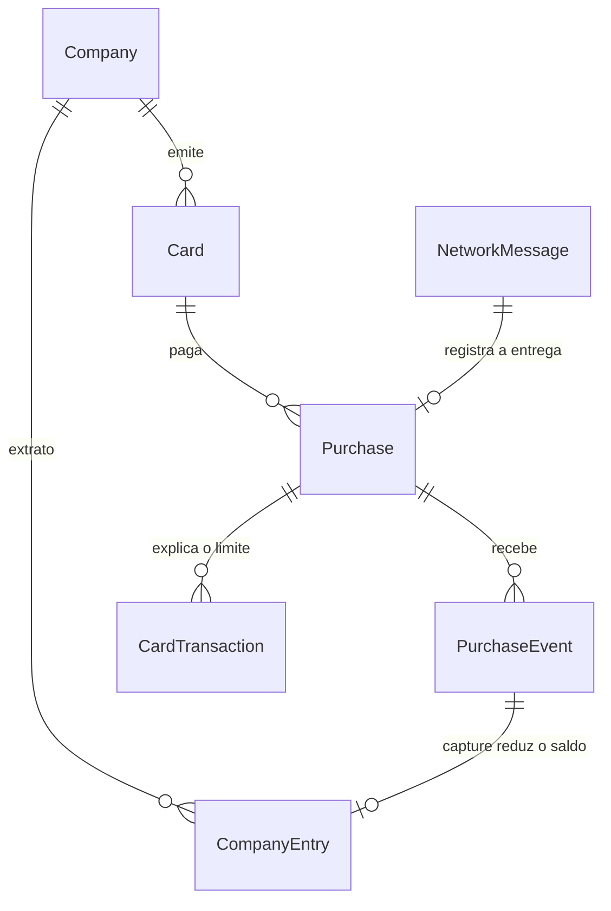

# MODEL.md

Este arquivo é o coração da sua entrega. Escreva-o durante o desafio, não depois.

## 1. O modelo

- **Company.** Uma linha da Acme, travada quando duas compras concorrem pelo mesmo saldo.
- **Card.** Limite mensal, teto por compra, MCCs bloqueados e situação pertencem ao cartão.
- **Purchase.** A authorization e a decisão única. Os events se agrupam nela.
- **PurchaseEvent.** Capture ou cancellation, sem reabrir a decisão. Event que chega antes da authorization fica com `purchase_id` vazio.
- **CardTransaction.** Linha do statement do cartão. O que já apareceu não muda de `occurred_at`, `type`, `amount_cents` ou `reference`.
- **CompanyEntry.** Linha do extrato da empresa. Depósito soma, capture subtrai. O saldo é a soma, lida na hora.
- **NetworkMessage.** A entrega da rede. O mesmo `id` devolve a resposta já dada. `fact_fingerprint` vazio na authorization. No event, o fingerprint igual com `id` novo é o mesmo fato.

O statement do cartão sai em `occurred_at` crescente e, no empate, `reference` crescente. O extrato da empresa sai em `occurred_at` crescente e, no empate, o id interno. O mês da compra é o mês do `occurred_at` da authorization, no fuso `America/Sao_Paulo`. Capture de outro mês continua nesse mês.

## 2. Decisões

1. A compra guarda a authorization e a decisão. Capture e cancellation são events. O efeito no limite do cartão é uma `CardTransaction`. O efeito no saldo da empresa é uma `CompanyEntry`. Uma tabela só misturaria a decisão, que não muda, com a linha de extrato, que também não muda, e com o event que ainda pode chegar.

2. A reserva entra no statement. Na aprovação o limite restante cai, e a etapa 3 chama isso de transaction (`hold`, valor negativo, `reference` o id da authorization). Capture do mesmo valor não gera outra linha no cartão. Capture maior gera `adjustment` só com a diferença. Sobra liberada no `final` ou na cancellation gera `adjustment` positivo. Hesitei em mostrar só o capturado, que é mais fácil de ler. O limite cairia sem uma linha que explicasse a queda.

3. Capture acima do teto esperado é aceita e aplicada. A rede já cobrou. `4xx` viraria pendência manual. A compra fica marcada como problema. P2 captura 86.000 centavos sobre 80.000, dentro dos 20% de hotel. P3 captura 48.000 sobre 40.000, exatamente no limite (`48000 × 100 = 40000 × 120`), então não é problema.

4. Na aprovação, a compra segura o valor autorizado, no limite do cartão e no saldo disponível da empresa. Depois de uma capture parcial, segura o que ainda não foi capturado, até o autorizado. No `final: true`, o que passar do autorizado é consumo a mais e a sobra autorizada volta. Na cancellation, volta o que ainda estava reservado. O que já foi capturado continua no saldo.

5. Problema é compra cujo total capturado passou, estritamente, do teto esperado: 20% nos MCC 5812, 7011 e 7512, e o autorizado nos demais. Também é problema capture que chega depois de uma cancellation. Compra ainda sem `final` não é problema. Event sem authorization aparece na lista própria do painel, não nesta. Hesitei em marcar toda compra sem `final`. O painel encheria de compra em voo.

6. Event que chega antes da authorization fica guardado e não mexe em saldo. A decisão usa o estado do momento em que a authorization é processada, sem descontar esse event. Depois da decisão, os events guardados entram por `sequence`. Capture depois de cancellation é aceita, aplicada, e a compra vira problema. A alternativa era deixar o event antecipado reduzir o que ainda cabe aprovar. O desempate do enunciado é aprovar e registrar o alerta.

7. Todos os valores da compra caem no mês do `occurred_at` da authorization, em `America/Sao_Paulo`. O saldo da empresa não tem mês. A alternativa era jogar cada capture no mês dela. Uma capture em outubro furaria o limite de setembro, que foi o mês da decisão.

8. Limite restante, disponível e saldo são recalculados na leitura, somando as linhas. Hesitei em guardar uma projeção atualizada a cada transaction. Com até 20 mensagens, a projeção é outra coisa para divergir do invariante.

9. Cada tabela tem chave própria. O id da rede fica ao lado, único. O `reference` do statement é esse id. Usar o id da rede como chave quebra na reemissão, que traz outro id para o mesmo fato.

10. O mesmo `id` é a mesma entrega: a resposta gravada volta e o efeito não repete. Id novo com o resto idêntico é reemissão de event: o id novo fica registrado e o efeito não repete. O resto é tipo, authorization, `occurred_at`, valor, moeda, `sequence` e `final`. Authorization repetida chega com o mesmo id. Dois pagamentos iguais, com ids diferentes, continuam sendo dois fatos.

## 3. Riscos e garantias

Os riscos que você identificou neste domínio. Para cada um: o que pode dar errado, o que no seu código impede que aconteça e qual teste prova isso.

Fecha quando o código da rede e os testes dessa garantia existirem.

## 4. O que eu esperava dos cenários

P1 fecha como o enunciado: depois das cinco captures exatas, a Ana fica com disponível e limite restante 143000, o statement dela fecha em 143000, e o Diego fica com disponível 943000 e limite restante 5000000. Nenhuma compra é problema. A reserva e a capture do mesmo valor não se somam duas vezes.

P2, Ana, MCC 7011. 800,00 é igual ao teto dela, então a autorização aprova. Cada capture parcial só move o saldo da empresa. O limite da Ana só muda na última, quando o capturado passa de 80.000 para 86.000 e ainda cabe nos 20% do hotel.

| Depois de | Limite restante da Ana | Disponível da Ana | Disponível do Diego | Problema |
|---|---:|---:|---:|---|
| Autorização de 800,00 | 120000 | 120000 | 920000 | não |
| Capture de 300,00 | 120000 | 120000 | 920000 | não |
| Capture de 300,00 | 120000 | 120000 | 920000 | não |
| Capture de 260,00, final | 114000 | 114000 | 914000 | não |

P3, Bruno, MCC 5812. A capture de 480,00 sobre 400,00 está no limite inclusive da regra dos 20%, então não é problema. 50,00 passa dos 2.000 que sobraram e recusa com `monthly_limit_exceeded`. 20,00 é igual ao que sobrou e aprova.

| Depois de | Limite restante do Bruno | Disponível do Bruno | Disponível do Diego | Problema |
|---|---:|---:|---:|---|
| Autorização de 400,00 | 10000 | 10000 | 960000 | não |
| Capture de 480,00, final | 2000 | 2000 | 952000 | não |
| Autorização de 50,00, recusada | 2000 | 2000 | 952000 | não |
| Autorização de 20,00, aprovada | 0 | 0 | 950000 | não |

Ainda não rodei essas mensagens. O código que aplica authorization e event não existe. Quando rodar, esta seção ganha se bateu e o que mudou.

## 5. O que mudou e o que foi descartado

Alterações relevantes do modelo ao longo do caminho, com o motivo. E o que o seu primeiro rascunho, ou a IA, propôs e você não aceitou.

Fecha quando houver código para comparar com este texto.
